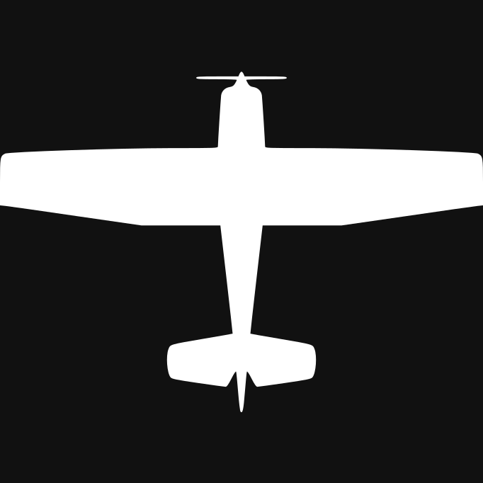
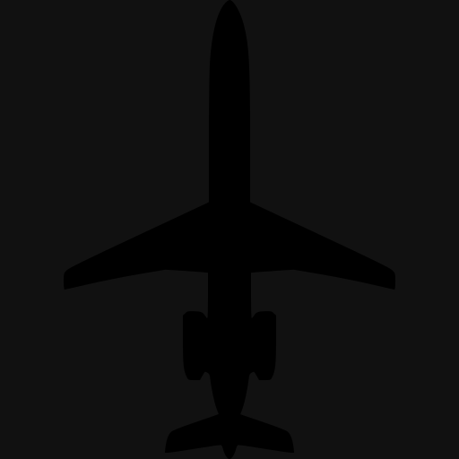

# SkyWatch Guide

[← Back to README](README.md)

SkyWatch shows a live radar of all aircraft within 50 nm (~90 km / 55 mi) of your location, updated every 15 minutes.

---

## Reading the Display

Each aircraft appears as an icon pointing in its direction of travel, with a label attached.

**Label lines:**
1. **Callsign** — flight number or registration (e.g. BAW123, G-ABCD)
2. Aircraft type description (e.g. Airbus A320, Robinson R44)
3. Altitude · Speed (e.g. 35,000 ft · 480 kt)

**Brightness** reflects altitude — brighter icons are higher up, darker icons are low or on the ground.

**Airports** are marked with a crosshair symbol and IATA code. See [AIRPORTS.md](AIRPORTS.md) for the full list of displayed airports with IATA/ICAO codes and locations.

**Emergency squawks** are shown at full brightness with a dashed ring and a HIJACK / NORDO / MAYDAY label:

| Squawk | Meaning |
|--------|---------|
| 7500 | Hijack |
| 7600 | No radio (NORDO) |
| 7700 | Mayday / general emergency |

---

## Cross-section view

Set **Display** to *Cross-section* for a vertical slice of the sky around home instead of the map: altitude up, distance across. Only the full layout draws it; the half and quadrant layouts keep the radar.

| Horizontal axis | Meaning |
|---|---|
| Distance from home | Range from home, left to right; each label adds a compass bearing (NE) |
| East-West | West left, east right, home in the middle |
| Runway / custom heading | Offset along the heading you set (270 for runway 27); aircraft more than a third of the radius off that line are dimmed and carry no label |

- The low band (0 to 10,000 ft) gets 45 % of the height, so approaches and departures are readable; the top of the chart is 20k, 30k, 40k or 50k ft depending on the highest aircraft.
- The inner third of the radius gets half of the width.
- Icons face the direction of travel along the axis and tilt when climbing or descending faster than 500 ft/min; the ground strip sits at the nearest airport's field elevation.
- At most 12 aircraft are drawn: emergencies first, then the nearest low ones, then the highest.

- **Sun and moon** (setting *Show Sun and Moon*): computed from the time and your location, no extra requests. Each body above the horizon is an icon (the moon in its current phase) at the plot edge, at the position along the axis where its direction from home would leave the chart, with its elevation and compass direction. Below the horizon the icon sits at the end of the ground strip with "rises" and the time.
- The horizontal axis is enlarged for the first 15 nm (30 km): that zone takes half the width, is shaded faintly and marked with a break (//).

- **Terrain:** the ground under the strip is real. Elevation comes from AWS Terrain Tiles (Mapzen terrain), fetched once per location and cached for 90 days. East-West and heading axes show the profile along that line; the distance axis shows the highest ground at each distance (the skyline). Without terrain data the strip stays flat at the airport's elevation.
- **Towns** (setting *Show Towns*, on by default): up to six of the most populous towns are named along the ground strip, from GeoNames (CC BY 4.0). On the heading axis only towns close to the line are shown.

Cross-section view inspired by Avation-Cross-section.

## Closest aircraft panel

Setting *Show Closest Aircraft Details* (full layout, radar and cross-section) adds a panel for the airborne aircraft nearest to home: callsign, type, altitude, speed, vertical rate, distance and bearing, route with progress, phase of flight (taking off, climbing, cruising, descending, approach, on the ground), distance to go and an estimated arrival time (from the distance to the destination and the current speed). An emergency squawk shows at the top. The aircraft is ringed on the chart. *Clock Format* sets 12 or 24 hour times for the arrival and sun/moon times; Automatic follows the units.

## Settings that depend on others

The cross-section settings (axis, heading, sun and moon) only show when *Display* is Cross-section, and the heading only when the axis is Runway / custom heading. A hidden setting keeps its value but is ignored.

## How ADS-B Works

Every commercial aircraft continuously broadcasts its position, altitude, speed, and identity on 1090 MHz using an ADS-B transponder. A global network of volunteers runs ground receivers that pick up these signals and feeds them to [airplanes.live](https://airplanes.live), which powers SkyWatch.

---

## Aircraft Icons

Icons sourced from [ADS-B Radar](https://adsb-radar.com/). Matched first by ICAO type code, then by ADS-B emitter category.

### Specific Aircraft Types

| Icon | Aircraft |
|------|----------|
|  | Airbus A318 / A319 / A320 / A321 |
|  | Airbus A330 family |
|  | Airbus A340 family |
|  | Airbus A380 |
|  | Boeing 737 family |
|  | Boeing 747 family |
|  | Boeing 767 family |
|  | Boeing 777 family |
|  | Boeing 787 Dreamliner |
|  | Cessna (C172, C152, C182, …) |
|  | Bombardier CRJ family |
|  | Bombardier Dash 8 / Q-Series |
|  | Embraer E190 / E195 |
|  | Embraer ERJ-135 / 145 / 170 / 175 |
|  | Fokker 70 / 100 |
|  | McDonnell Douglas MD-11 |
|  | Gulfstream G450 / G550 / G650 |
|  | Dassault Falcon 7X / 8X / 50 / 900 |
|  | Learjet 35 / 45 / 55 / 60 |
|  | Lockheed C-130 Hercules / C-17 / C-5 |
|  | F-15 / F-16 / F-18 / F-22 / F-35 |
|  | Northrop F-5 |
|  | General Dynamics F-111 |

### ADS-B Emitter Category Fallbacks

Used when no specific ICAO type match is found.

| Icon | Category | Description |
|------|----------|-------------|
|  | A0 | No emitter category info |
|  | A1 | Light (< 15,500 lbs) |
|  | A2 | Small (15,500–75,000 lbs) |
|  | A3 | Large (75,000–300,000 lbs) |
|  | A4 | High vortex large (e.g. B757) |
|  | A5 | Heavy (> 300,000 lbs) |
|  | A6 | High performance (> 5g or > 400 kt) |
|  | A7 | Rotorcraft / helicopter |
|  | B0 | No emitter category info (non-motorised) |
|  | B1 | Glider / sailplane |
|  | B3 | Parachutist / skydiver |
|  | B4 | Ultralight / hang-glider / paraglider |
|  | C0–C3 | Surface vehicle / ground traffic |